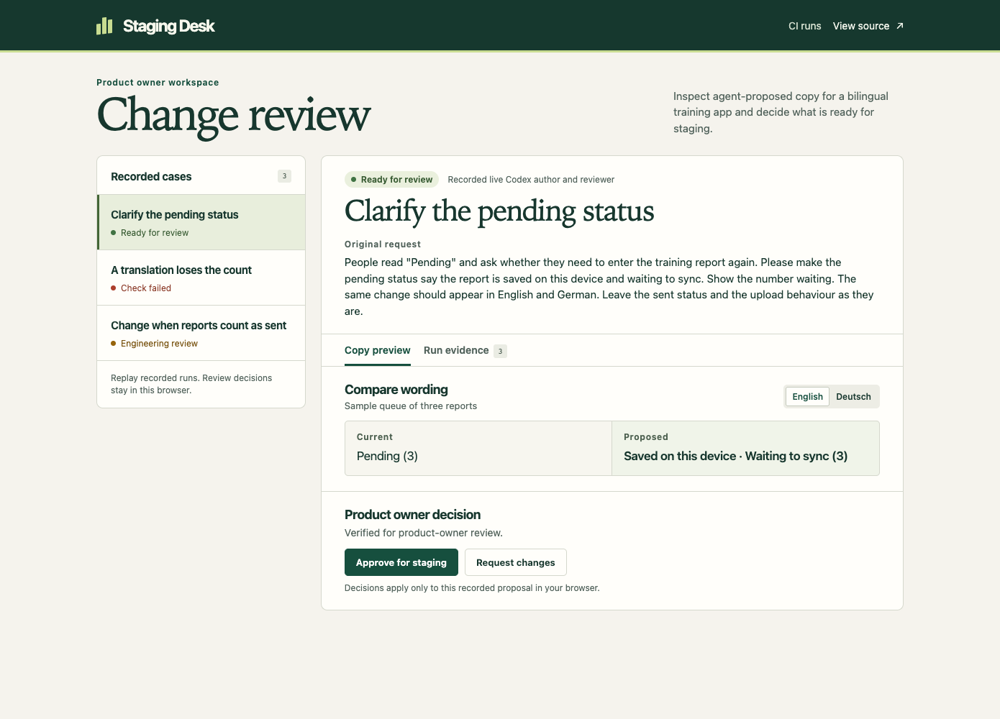

# Staging Desk

**Can a product owner improve what a screen says without accidentally changing what the software does?** Staging Desk makes that boundary visible. Try a bilingual copy request, inspect an independent agent’s review, then see how a failed check or a change to sync behaviour takes a different route.

**[Open the live review desk](https://willbrealey.github.io/staging-desk/)** · [Inspect the implementation PR](https://github.com/willbrealey/staging-desk/pull/1) · [Read the two model outputs](evidence/ready/)

Fourteen Python tests passed on the first implementation. An independent reviewer then changed the original German wording and found that the old approval still counted. The [failing CI run](https://github.com/willbrealey/staging-desk/actions/runs/45188585686) and [fix](https://github.com/willbrealey/staging-desk/commit/86df24036674d3bb3691fdb0e5864bc750290cdf) show the mistake and how to reproduce it.

[](https://willbrealey.github.io/staging-desk/)

## Try the three requests

| Open a case | What you can do | What determined the result |
| --- | --- | --- |
| [Clarify the pending status](https://willbrealey.github.io/staging-desk/#ready) | Compare the English and German screen text. Approve the staged proposal or ask for changes. | Two real, separate Codex sessions produced and reviewed this proposal. Its scope and placeholders passed deterministic checks. |
| [A translation loses the count](https://willbrealey.github.io/staging-desk/#blocked) | Inspect the German proposal and find the failed check. | This deliberately broken example drops a dynamic count. The checker blocks it before a second model call. |
| [Change when a report counts as sent](https://willbrealey.github.io/staging-desk/#escalated) | Open the engineer handoff and inspect the requested behaviour change. | This constructed case asks to treat a local save as a successful upload. It leaves the copy-review route. |

The **product owner** reviews language and decides if a proposal is ready for staging. The **engineer** owns state transitions, permissions, tests and releases. The training staff whose screen is being changed see the report status. The hosted desk replays synthetic cases without a login, API key or model fee. Your staging decisions stay in your browser. To submit a fresh natural-language request, use the CLI below.

## What to inspect as an engineer

1. **Agent orchestration.** [The acceptance brief](docs/acceptance.md) defines a shared interface for the Vue and Python work. Agents implemented those parts in isolated Git worktrees, then an independent reviewer examined the integrated change. Inside the running workflow, a read-only author proposes copy. A fresh reviewer sees the original request and candidate without the author’s rationale. Each role has one model call and a 120-second timeout. [Runner](run_agent.py) · [Agent delivery record](docs/delivery.md)
2. **Tests that can disagree with a model.** The Python gate checks the editable key, supported locales, placeholder contract and reviewer verdict. Each acceptance belongs to one request, one pair of original labels, one proposal and one review. CI independently replays the examples, rebuilds the Vue app and exercises the product-owner decisions in Chromium. The CI replay needs no model credentials. [Python tests](test_workflow.py) · [Browser tests](web/tests/) · [CI definition](.github/workflows/verify.yml)
3. **A controlled handoff to staging.** The author supplies data for one display key. A missing or stale review blocks the proposal. A verified case still needs a human decision. Only the Pages deployment job receives publishing permissions, and it runs after verification on the default branch. [Decision code](workflow.py) · [Recorded cases](evidence/)

## Run locally

Requires Python 3.9+ and Node 22.23+. From the repository root:

```sh
python3 -m unittest -v
python3 workflow.py export --check
cd web
npm ci
npm run dev
```

To exercise the browsers locally, run `npm run build`, `npx playwright install chromium` and `npm test` from `web/`. To see the exact hard stop for a bad proposal, run `python3 workflow.py replay evidence/blocked` from the repository root. Exit status 1 is the expected result.

## Make a fresh proposal

With a signed-in Codex CLI, pass a request file and a new output directory from the repository root:

```sh
python3 run_agent.py examples/request.txt .preview-my-run
python3 workflow.py replay .preview-my-run
```

The CLI writes the request, structured model outputs and gate receipt to disk. Read the JSON directly or replay it. The public catalog is built only from the curated cases in `evidence/`. Files in a fresh run stay local.

## Boundaries and trade-offs

The accepted sample used two Codex sessions. The CLI reported 17,997 tokens for the author and 18,300 for the reviewer. These are observed token counts, without a billing estimate. The German placeholder check makes a second call unnecessary when the proposal loses the count. A fresh reviewer still has to judge whether wording that passes those checks communicates the intended meaning.

The demo stores decisions locally and uses synthetic training reports. Hashes tie decisions to recorded bytes. They do not authenticate an individual reviewer. A production service would need authenticated users, tenant isolation, durable approvals and a release policy. This independent work sample was inspired by the product-owner/staging workflow in [IMPedia’s engineering role](https://swissdevjobs.ch/jobs/Institute-of-Medical-Procedures-Software-Engineer-Agentic-AI).
